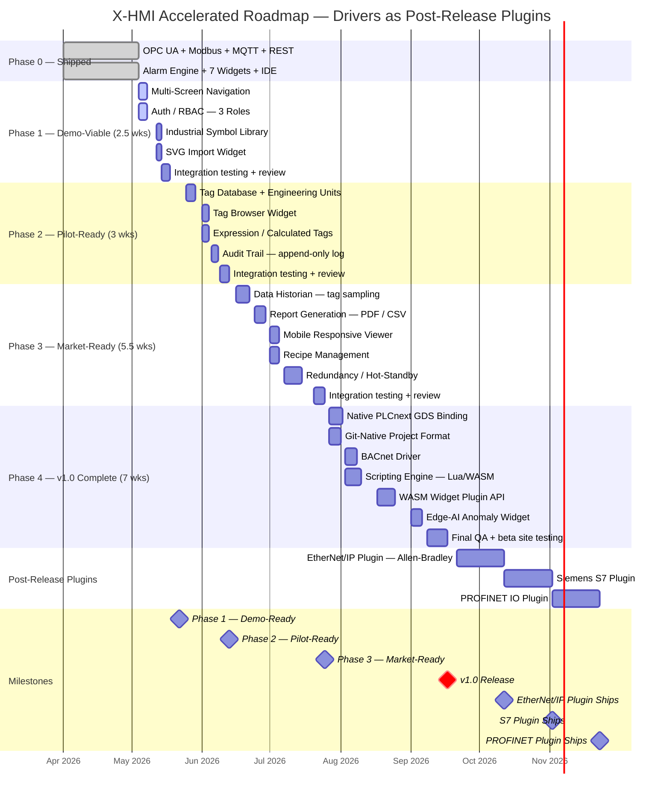

# X-HMI Development Roadmap

**Target:** Production-ready industrial HMI platform (Go runtime + React IDE)  
**Hardware:** Phoenix Contact PLCnext AXC F 3152  
**Start date:** 2026-05-04 | **v1.0 target:** 2026-09-17

> EtherNet/IP, Siemens S7, and PROFINET IO drivers are post-release plugins shipped after v1.0.
> They are excluded from the critical path to keep v1.0 scope tight and hardware testing off the schedule.

---

## Roadmap Diagram



---

## Phase Detail

### Phase 0 — Shipped ✅
*Status: Complete as of 2026-05-04*

#### Runtime
| Feature | Notes |
|---|---|
| OPC UA Driver | Reads/writes nodes on PLCnext OPC UA server |
| Modbus TCP Driver | Coils, discrete inputs, holding/input registers |
| MQTT Driver | Subscribe + publish, configurable broker |
| REST Driver | HTTP polling for JSON tag values |
| Alarm Engine | Rule evaluation, event queue, ACK, WebSocket push to clients |

#### IDE
| Feature | Notes |
|---|---|
| Drag-Drop Canvas | Free-placement widget layout |
| Property Editor | Per-widget configuration panel |
| Widget Palette | Gauge, Trend (multi-series), LED, Button, Numeric I/O, Text I/O, History Log |
| File Save / Load | `.xhmi.json` project format |
| Status Bar | Runtime connection state indicator |

---

### Phase 1 — Demo-Viable
*Target: 2026-05-22 | Duration: 2.5 weeks*

Goal: show X-HMI to a real plant visitor without apology.

#### Runtime
| Feature | Notes |
|---|---|
| **Auth / RBAC** | HTTP session tokens. Three built-in roles: `Admin`, `Operator`, `Viewer`. Roles stored in project config. Restricts widget interaction by role (e.g., Viewer cannot write setpoints). |

#### IDE
| Feature | Notes |
|---|---|
| **Multi-Screen Navigation** | Screen registry in project JSON. Screen Tree panel in IDE sidebar. Navigator widget (button that links to a named screen). Popup/overlay screen type. React router drives canvas switching in viewer. |
| **Industrial Symbol Library** | ~100 ISA-5.1 compliant SVG symbols: pumps, valves, tanks, conveyors, motors, fans, heat exchangers, sensors. Bundled as static assets. Searchable palette panel. |
| **SVG Import Widget** | Drop an `.svg` file onto canvas. Expose CSS custom properties (fill, stroke, opacity, transform) as bindable tag expression slots. Enables P&ID backgrounds and OEM equipment graphics. |

---

### Phase 2 — Pilot-Ready
*Target: 2026-06-13 | Duration: 3 weeks*

Goal: run a paid pilot at a real PLCnext customer site.

#### Runtime
| Feature | Notes |
|---|---|
| **Tag Database** | Named tag registry (name, driver path, data type, engineering unit label, raw→EU scaling, deadband). Persisted in project JSON. All widgets bind to tag names, not raw driver paths. |
| **Expression / Calculated Tags** | Safe expression evaluator (`govaluate` or small AST). References other tag names. Supports arithmetic, comparisons, boolean logic, `min()`, `max()`, `avg()`. Evaluated on tag-change events. Depends on Tag Database. |
| **Audit Trail** | Append-only SQLite table: `timestamp`, `user`, `action`, `tag_name`, `old_value`, `new_value`. Captures setpoint writes, alarm ACKs, and login/logout events. Exportable as CSV. |

#### IDE
| Feature | Notes |
|---|---|
| **Tag Browser Widget** | Sidebar panel showing the live tag database tree. Drag a tag onto a widget property slot to bind it. Shows live value, EU, and quality status. |

---

### Phase 3 — Market-Ready
*Target: 2026-07-25 | Duration: 5.5 weeks*

Goal: displace Clarity in PLCnext shops; quote against Ignition in RFPs.

#### Runtime
| Feature | Notes |
|---|---|
| **Data Historian** | Periodic tag sampling (configurable rate per tag, default 1 s). Storage: SQLite for edge, InfluxDB HTTP for cloud. Configurable retention window. Powers trend replay beyond live window. |
| **Redundancy / Hot-Standby** | Two X-HMI nodes share project file via NFS/SMB. Heartbeat ping between primary and standby. Standby promotes on missed heartbeats. Clients reconnect via a virtual IP. |

#### IDE
| Feature | Notes |
|---|---|
| **Report Generation** | Scheduled and on-demand reports. Templates: shift alarm summary, tag value table, trend image. Output: PDF (via headless Chromium or Go PDF lib) and CSV. Email delivery via SMTP. |
| **Mobile Responsive Viewer** | Separate React build with responsive breakpoints (phone, tablet). Read-only by default; write controls behind Operator role. Same WebSocket runtime, different shell. No IDE in this build. |
| **Recipe Management** | Named parameter sets (recipe name → map of tag:value pairs). Download a recipe = bulk-write all values in one operation. Recipe library stored in project JSON. Import/export CSV. |

---

### Phase 4 — v1.0 Complete
*Target: 2026-09-17 | Duration: 7 weeks*

Goal: platform depth and competitive moats no incumbent can easily match.

#### Runtime
| Feature | Notes |
|---|---|
| **Native PLCnext GDS Binding** | Read/write PLCnext Global Data Space directly via shared memory or the PLCnext C++ SDK. Bypasses OPC UA entirely: lower latency, zero configuration, no address-space setup. Unique to X-HMI. |
| **BACnet Driver** | BACnet/IP for building automation overlap (HVAC, chillers). Opens pharma and campus infrastructure markets. Ships in core runtime — small library footprint, no hardware testing bottleneck. |
| **Scripting Engine** | Embedded Lua sandbox (`gopher-lua`) or WASM-isolated JS. Event hooks: `on_tag_change`, `on_alarm`, `on_timer`, `on_screen_load`. Enables complex logic without PLC programming. |

#### IDE
| Feature | Notes |
|---|---|
| **Git-Native Project Format** | `.xhmi.json` is human-readable and diff-friendly. First-class `git init` flow in IDE. Branch, commit, and merge HMI projects. Visual diff of screen layouts. No incumbent supports this. |
| **WASM Widget Plugin API** | Third-party widgets compiled to WASM, loaded at runtime. Sandboxed — no access to Go runtime internals. Plugin manifest declares tag bindings and property schema. Foundation for all post-release driver plugins. |
| **Edge-AI Anomaly Widget** | Bundles a minimal ONNX Runtime. Pre-trained univariate anomaly model runs on tag streams. Widget shows confidence band and highlights anomalous samples. Deployable on PLCnext ARM hardware. |

---

### Post-Release Plugins
*Shipping after v1.0 | Each plugin: ~3 weeks including hardware testing*

These drivers were removed from the v1.0 critical path because each requires dedicated PLC hardware bench time for protocol testing — hardware testing is the hard floor that dominates their schedule. Moving them post-release lets v1.0 ship ~6 weeks earlier. The WASM Plugin API (Phase 4) provides the loading and distribution infrastructure for all three.

| Plugin | Ships | Target PLC Families | Library |
|---|---|---|---|
| **EtherNet/IP** | 2026-10-12 | Allen-Bradley CompactLogix, ControlLogix, MicroLogix | `libplctag` via CGo |
| **Siemens S7** | 2026-11-02 | S7-300, S7-400, S7-1200, S7-1500 | `go-s7` or `libnodave` |
| **PROFINET IO** | 2026-11-23 | PLCnext native cyclic IO, any PROFINET controller | PLCnext C++ SDK |

Each plugin ships as a `.wasm` (or native `.so` on PLCnext) loaded by the Plugin API, with a corresponding IDE configuration panel. Customers on sites with Rockwell or Siemens PLCs can install the relevant plugin without waiting for v1.0.

---

## Architecture Split: IDE vs Runtime

```
┌─────────────────────────────────────────────────────────────┐
│                      Go Runtime (server)                     │
│                                                             │
│  ┌──────────────────────────────┐  ┌───────────────────┐   │
│  │  Driver Hub (built-in)       │  │   Tag Engine      │   │
│  │  OPC UA  │ Modbus TCP        │  │   Tag DB          │   │
│  │  MQTT    │ REST              │  │   Expressions     │   │
│  │  BACnet  │ GDS Binding       │  │   Historian       │   │
│  │  ─ ─ ─ ─ ─ ─ ─ ─ ─ ─ ─ ─  │  │   Scripting       │   │
│  │  Plugin API (post-release)   │  │   Recipes         │   │
│  │  EtherNet/IP │ S7 │ PROFINET │  └───────────────────┘   │
│  └──────────────────────────────┘                           │
│                                      ┌───────────────────┐  │
│  ┌──────────────────────────────┐    │   Alarm Engine    │  │
│  │   HTTP API + WebSocket       │    │   Rules           │  │
│  │   Tag read/write             │    │   Event Queue     │  │
│  │   Alarm subscribe            │    │   WebSocket push  │  │
│  │   Auth endpoints             │    │   Audit Trail     │  │
│  │   Report generation          │    └───────────────────┘  │
│  │   Recipe download            │                           │
│  └──────────────────────────────┘    ┌───────────────────┐  │
│                                      │   Auth / RBAC     │  │
│                                      │   Sessions        │  │
│                                      │   Role enforcement│  │
│                                      └───────────────────┘  │
└─────────────────────────────────────────────────────────────┘
                          ▲ HTTP / WS
┌─────────────────────────────────────────────────────────────┐
│                     React IDE + Viewer                       │
│                                                             │
│  IDE Shell                    Viewer Shell (mobile-ready)   │
│  ┌──────────────────────┐    ┌────────────────────────────┐ │
│  │  Canvas (DnD)        │    │  Canvas (read/execute)     │ │
│  │  Widget Palette      │    │  Responsive breakpoints    │ │
│  │  Symbol Library      │    │  Touch controls            │ │
│  │  SVG Import          │    └────────────────────────────┘ │
│  │  Property Editor     │                                   │
│  │  Tag Browser         │    Widget Set                     │
│  │  Screen Tree         │    ┌────────────────────────────┐ │
│  │  Report Designer     │    │  Gauge / LED / Button      │ │
│  │  Recipe Editor       │    │  Trend (multi-series)      │ │
│  │  Script Editor       │    │  Numeric / Text I/O        │ │
│  │  Git integration     │    │  History Log               │ │
│  │  Plugin Manager      │    │  SVG (tag-bound)           │ │
│  └──────────────────────┘    │  Symbol instances          │ │
│                              │  Navigator                 │ │
│                              │  Audit Trail Table         │ │
│                              │  Edge-AI Anomaly           │ │
│                              │  WASM plugin widgets       │ │
│                              └────────────────────────────┘ │
└─────────────────────────────────────────────────────────────┘
```

---

## Key Milestones

| Date | Milestone | Gate Criteria |
|---|---|---|
| **2026-05-22** | Demo-Ready | Multi-screen nav, login, symbols, SVG backgrounds work end-to-end on demo hardware |
| **2026-06-13** | Pilot-Ready | Tag DB + expressions + audit trail deployed at one beta customer site |
| **2026-07-25** | Market-Ready | Historian, reports, mobile viewer, redundancy — can quote against Ignition in RFPs |
| **2026-09-17** | **v1.0 Release** | Full platform: scripting, WASM plugins, GDS binding, Git integration, AI anomaly widget |
| **2026-10-12** | EtherNet/IP Plugin | Allen-Bradley connectivity available in Plugin Manager |
| **2026-11-02** | S7 Plugin | Siemens connectivity available in Plugin Manager |
| **2026-11-23** | PROFINET Plugin | PROFINET cyclic IO available in Plugin Manager |
